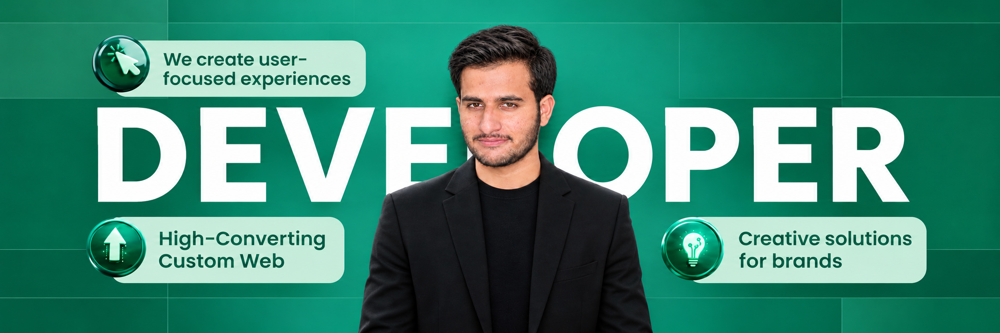

 

## About me

I am a **full-stack SaaS engineer** focused on turning product ideas into fast, maintainable software. I work across product interfaces, backend APIs, authentication, databases, subscriptions, analytics, and deployment—with a strong preference for clear UX and practical engineering.

- Building end-to-end SaaS products with TypeScript and modern web technologies
- Comfortable across frontend architecture, backend systems, and product delivery
- Interested in developer tooling, automation, AI-assisted workflows, and native Android
- Open to freelance projects, product collaborations, and ambitious engineering work

## Core stack

## Selected public projects

<table>
<tr>
<td width="50%" valign="top">

### [Analytics SaaS](https://github.com/waseemakram-dev/analytics-saas)

Full-stack analytics platform with separate frontend and backend applications, authentication, PostgreSQL, Prisma, AI integrations, and interactive reporting.

</td>
<td width="50%" valign="top">

### [WATE Programming Language](https://github.com/waseemakram-dev/wate)

Programming-language ecosystem with an AST parser, bytecode VM, sandboxed runtime, LSP, REPL, package manager, and browser playground.

</td>
</tr>
<tr>
<td width="50%" valign="top">

### [SaaS Live Chat](https://github.com/waseemakram-dev/SAAS-LIVE-CHAT)

Modern customer-support chat dashboard designed for responsive SaaS product experiences.

</td>
<td width="50%" valign="top">

### [Calli Qalam](https://github.com/waseemakram-dev/Calli-Qalam)

Creative digital calligraphy experience combining expressive typography, modern motion, Supabase, and AI-assisted features.

</td>
</tr>
<tr>
<td width="50%" valign="top">

### [D-Mall Official](https://github.com/waseemakram-dev/dmall-official)

Responsive business landing experience with structured content and optimized Cloudinary media delivery.

</td>
<td width="50%" valign="top">

### [Outreach Automation Panel](https://github.com/waseemakram-dev/mock_automation_panel)

Dashboard for outreach workflows, AI-assisted content, lead automation, email delivery, Firebase, and campaign analytics.

</td>
</tr>
</table>

## Engineering focus

| Product engineering | Platform foundations | User experience |
| --- | --- | --- |
| SaaS workflows and subscriptions | Secure APIs and role-based access | Responsive, accessible interfaces |
| Analytics and reporting | PostgreSQL and Prisma architecture | Reusable design systems |
| AI-assisted business tools | Authentication and integrations | Clear onboarding and feedback |

## GitHub activity

 

